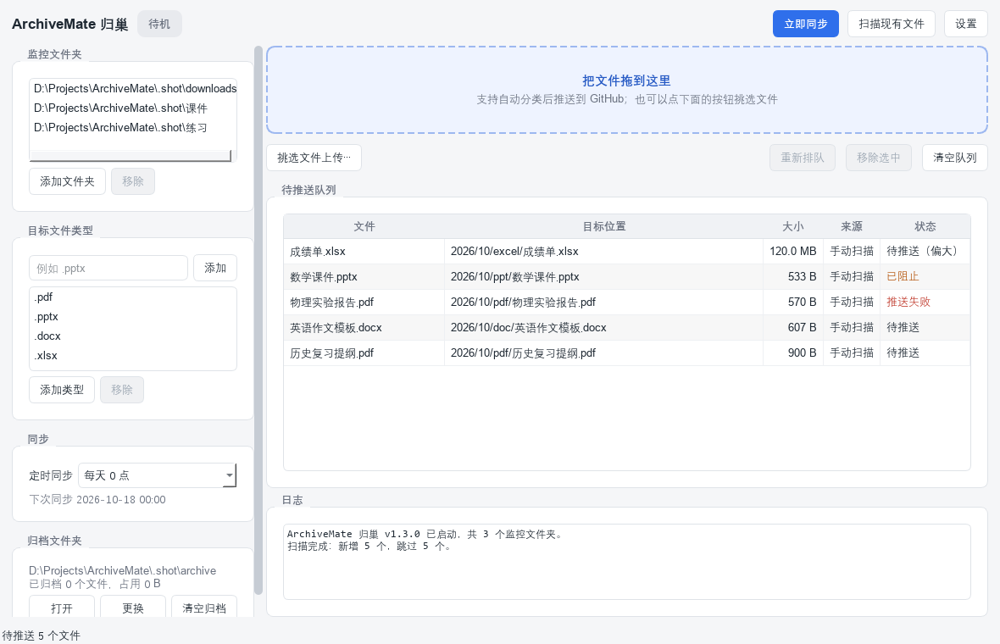

# ArchiveMate 归巢

把学校下发的文件（作文模板、课件、PDF、Word…）**自动归档并推送到 GitHub 私有仓库**的桌面软件。

面向普通学生用户：装完就能用，不需要懂 git。目标是做成能直接拷给同学用的成品软件，
而不是一个自用脚本。

- 释放本地磁盘空间
- 云端统一管理、可检索
- 保留版本历史（Git 天然支持）
- 隐私优先：私有仓库 + Token 存系统密钥链，不落明文

> 面向使用者的操作手册见 **[docs/使用说明.md](docs/使用说明.md)**。
> 本文件面向开发和维护。



---

## 快速开始

### 使用者

1. 解压整个 `ArchiveMate` 文件夹（**不要只拿 exe**，运行库在 `_internal/` 里）。
2. 双击 `ArchiveMate.exe`。
3. 跟着三步引导填 GitHub Token、选仓库、选监控文件夹。

### 开发者

```powershell
# 依赖只有 PySide6 一个（Python 3.10+）
python -m pip install PySide6

# 直接跑图形界面
python -m archivemate

# 跑命令行（无界面，适合排查和自动化）
python -m archivemate --cli status
python -m archivemate --cli doctor

# 跑测试
$env:QT_QPA_PLATFORM = 'offscreen'      # 无头跑 GUI 测试
python -m unittest discover -s tests

# 打包成免安装成品
pwsh -NoProfile -File build.ps1
```

---

## 功能与需求对照

| 需求 | 实现位置 | 说明 |
| --- | --- | --- |
| 监控文件夹列表（可增删） | `service.py` / `watcher.py` / `gui/main_window.py` | 多文件夹并行，默认预填「下载」 |
| 拖拽上传 | `gui/widgets.py: DropArea` | 拖拽区 + 整个窗口都接受拖放，与自动监控共用同一处理流程 |
| 目标文件类型列表（可增删） | `config.py` / `gui/widgets.py: ListEditor` | 只有匹配扩展名的文件会被处理 |
| 按日期 + 类型自动分类 | `classify.py` | `YYYY/MM/<类型目录>/<文件名>`，如 `2026/10/ppt/数学课件.pptx` |
| 手动提交 + 定时同步 | `gui/main_window.py` / `config.py: SYNC_INTERVAL_CHOICES` | 两套入口并存，间隔可选 关闭/5/15/30 分钟/1 小时/每天 |
| 便携式配置文件 | `app_paths.py` | 存在 exe 同级目录，可随软件一起拷贝 |
| 推送成功后归档（非删除） | `sync.py: SyncEngine._archive_item` | `safe_move` 到归档目录，失败则保留队列下次重试 |
| 清空归档（二次确认） | `gui/main_window.py: _clear_archive` | 先报文件数与占用，再弹危险确认框 |
| GitHub 私有仓库 + 自动 commit message | `git_backend.py` / `sync.py: build_commit_message` | `add: 2026-10-11 数学课件.pptx` |
| 推送失败重试 + 日志 | `api_backend.py: push_with_retry` / `logging_setup.py` | 远端被抢先时重新读取再重试，默认 3 次 |
| 只上传新增文件，不下载仓库 | `api_backend.py: ApiGitBackend` | 走 Git Data API：`blobs → trees → commits → refs`，一次同步的流量 = 新增文件体积，与仓库历史无关 |
| Token 存系统密钥链 | `credentials.py` | Windows 凭据管理器 / macOS Keychain / Linux secret-tool |
| 密钥链失败降级为「本次手动输入」 | `credentials.py: remember_for_session` | **绝不默认存明文** |
| 单文件 50 MiB 提示 / 90 MiB 阻止 | `fsutil.py` | 阈值可在「设置 → 高级」调整 |
| 单次推送 2 GiB 以内 | `sync.py: chunk_by_size` | 自动分批提交 |
| 代理配置 | `config.py: GitConfig.proxy` / `github_api.py` | 同时作用于 git 与 GitHub REST API |
| HTTPS 证书后端可切换 | `config.py: GitConfig.ssl_backend` / `git_backend.py` | `http.sslBackend=schannel/openssl`；排查证书类推送失败 |
| 证书问题自动自愈 | `archivemate/tls_certs.py` / `git_backend.py: _heal_tls` | 证书类失败时自动「导出系统根证书 → 切 OpenSSL → 重试一次」，用户不用手改 git 配置 |
| 网络等待上限（不无限卡住） | `git_backend.py: run_command` / `config.py: GitConfig.network_timeout_seconds, stall_timeout_seconds` | 无管道子进程 + 停滞保护 + 硬超时，三层兜底 |
| 同步可中断 | `sync.py: SyncEngine.cancel` / `service.py: cancel_sync` / `gui/main_window.py: _cancel_sync` | 同步中显示「取消同步」，掐掉 git 进程，队列不丢 |
| 无需多设备同步 | — | 单机设计，不做同步协议 |
| 首次使用引导（非强制） | `gui/dialogs.py: OnboardingDialog` | 可跳过，之后在「设置」里随时改 |
| 一键打开 GitHub 新建 Token 页面 | `gui/dialogs.py: open_token_page / TOKEN_CREATE_URL` | 引导页与设置页各一个按钮，跳 `https://github.com/settings/tokens/new` |
| Token 即输即验 + 用户名自动填充 | `gui/dialogs.py: _ApiProbe / _auto_test_token` | 失焦或回车自动验一次，通过后把登录名填进「用户名」，失败显示红色原因 |
| 仓库名留空兜底 `school-files` | `config.py: DEFAULT_REPOSITORY_NAME / resolved_name` | 保存的配置与实际调用的 API 都用这个默认值 |
| 跨平台（Windows 优先） | 全部 | Windows 已实测；macOS / Linux 分支已写但未实机验证 |
| 低资源占用 | `watcher.py` | 轮询式监控，默认 5 秒一轮，不常驻大内存 |

---

## 目录结构

```
ArchiveMate/
├─ archivemate/                 应用包（纯标准库 + PySide6）
│  ├─ __main__.py               python -m archivemate 入口（默认 GUI，--cli 走命令行）
│  ├─ app_paths.py              便携式路径：配置/状态/日志/缓存放哪
│  ├─ config.py                 配置数据类、读写、同步间隔与文件类型规范化
│  ├─ credentials.py            跨平台密钥链（Windows 走 ctypes 调 advapi32）
│  ├─ classify.py               日期 + 类型 → 仓库内相对路径
│  ├─ fsutil.py                 体积阈值、稳定性判定、安全移动
│  ├─ api_backend.py            默认推送后端：走 GitHub REST 接口，不下载仓库已有文件
│  ├─ git_backend.py            bare 仓库 + 底层管道（hash-object/mktree/commit-tree/push）
│  ├─ github_api.py             纯 urllib 的 GitHub REST 客户端（含代理）
│  ├─ logging_setup.py          滚动文件日志 + 推给界面的回调
│  ├─ service.py                业务门面：监控 + 队列 + 同步 + 事件流（GUI 与 CLI 共用）
│  ├─ sync.py                   同步引擎：校验 → 刷新 → 提交 → 推送 → 归档
│  ├─ tracker.py                队列/历史状态的持久化
│  ├─ watcher.py                轮询式文件夹监控
│  ├─ cli.py                    完整无界面入口
│  └─ gui/                      PySide6 界面
│     ├─ main_window.py         主窗口
│     ├─ dialogs.py             设置 / 首次引导 / 统一确认框
│     ├─ widgets.py             列表编辑器、拖拽区、状态药丸
│     └─ theme.py               配色与样式表
├─ tests/
│  ├─ test_archivemate.py       核心逻辑 31 项
│  └─ test_gui.py               界面 14 项（离屏）
├─ tools/make_icon.py           用 Pillow 画应用图标
├─ packaging/
│  ├─ launcher.py               打包后的图形版入口
│  └─ cli_launcher.py           打包后的命令行入口
├─ archivemate.spec             PyInstaller 打包配置
├─ build.ps1                    一键打包（含跑测试 + 冒烟自检）
└─ docs/使用说明.md              面向使用者的手册
```

---

## 架构要点

### 1. 零第三方运行时依赖

需求文档建议用 `watchdog` / `GitPython` / `PyGithub` / `githubauthlib`。
本项目**全部换成了标准库实现**，理由：

- 打包体积和依赖地狱（PyInstaller + 一堆 C 扩展容易出问题）；
- 这三个库做的事情本身很薄——`GitPython` 只是 `git` 命令行的包装，
  `watchdog` 的事件式监控在 Windows 上对 OneDrive / 网络盘并不可靠，
  `githubauthlib` 的能力用 `ctypes` 直接调系统 API 就能覆盖。

实际测试下来，除了需要自己写 ~200 行轮询逻辑，没有损失功能。

### 2. 本地缓存是 bare 仓库，不 checkout 工作区

`cache/repo.git` 用 `git init --bare`，只通过底层管道操作：

```
hash-object -w  →  mktree  →  commit-tree  →  update-ref  →  push
```

**为什么不保留工作区副本**：如果本地再存一份文件，用户点「清空归档文件夹释放空间」就白做了。
bare 仓库里只有 blob 对象，文件内容确实存在，但那正是「推送成功后本地被移动」的那一份——
归档目录为空时，磁盘上就没有第二份。

### 3. Token 绝不出现在命令行

git 推送时通过环境变量注入配置：

```
GIT_CONFIG_COUNT=1
GIT_CONFIG_KEY_0=http.extraheader
GIT_CONFIG_VALUE_0=Authorization: Basic base64(x-access-token:TOKEN)
```

命令行上只放非敏感项（`-c credential.helper=` 清空、`-c core.askPass=`、`-c http.proxy=`）。
同时设 `GIT_TERMINAL_PROMPT=0`、`GCM_INTERACTIVE=Never`，Windows 上额外加
`CREATE_NO_WINDOW` 防止弹黑框。

### 4. 轮询监控 + 稳定性判定

`FolderWatcher` 每 5 秒扫一遍监控目录，对每个候选文件记录 `(size, mtime)` 指纹，
**跨轮持续 3 秒不变**才认为「下载完成」并交付给队列。避免刚创建、还在写入的文件被推废。

遍历时会跳过隐藏目录、`~$xxx.docx` 这类 Office 锁文件、以及 20 多个系统目录。

### 5. 界面与后台解耦

后台线程（监控、同步）不直接碰 Qt 控件，只往 `queue.Queue` 里塞事件；
主窗口用 200ms 的 `QTimer` 拉取并刷新。CLI 用同一套 `ArchiveMateService`，
所以两条入口的行为完全一致。

### 6. 重名不覆盖

推送前先 `ls-tree` 拿到远端已有路径，同名的自动加 ` (2)` 后缀。
远端已有 `2026/10/ppt/数学课件.pptx` 时，新的一份会变成 `2026/10/ppt/数学课件 (2).pptx`，
历史版本不会被顶掉。

### 7. git 子进程一律不用管道

`subprocess.run(timeout=...)` 在超时后只杀直接子进程，然后调用一次**没有超时的**
`communicate()`；而 git 会派生 `git-remote-https` 这类孙进程，它们继承并持有
stdout/stderr 的写端，EOF 永远不会到来 —— 于是「写了 timeout 却永远不返回」。
`close()` 也救不了：`subprocess` 的读线程正握着 `BufferedReader` 的内部锁，
`close()` 会死锁到孙进程退出为止。

所以 `git_backend.run_command()` 完全不用管道：stdout/stderr 直接写到
`tempfile.TemporaryFile()`，只调用 `process.wait(timeout=...)`（只依赖进程句柄，
不依赖 EOF），超时就用 `taskkill /F /T`（POSIX 用 `killpg`）收掉进程树，
再从临时文件读回输出。这条路径由 `TestRunCommandNeverHangs` 钉住。

配套的两层网络等待上限：

| 配置 | 默认 | 作用 |
| --- | --- | --- |
| `git.stall_timeout_seconds` | 60 | 传给 git 的 `http.lowSpeedLimit=1000` + `http.lowSpeedTime=N`，连接建立后数据停滞就放弃；`0` 表示关闭 |
| `git.network_timeout_seconds` | 1800 | 每次网络操作的硬上限，到点一定返回 |
| `git.stall_timeout_seconds` | 60 | 连接建立了但 60 秒内几乎没数据就放弃（真正的防卡死） |
| `git.ssl_backend` | `""`（跟随系统） | `schannel` / `openssl`；留空时若出错会自动修 |
| `git.ssl_ca_info` | `""` | 交给 OpenSSL 的 CA 包，留空则按需从系统证书库导出 |

同步进行中界面会出现「取消同步」按钮，它会 `taskkill` 掉当前 git 进程，
队列内容原样保留（`SyncEngine.cancel()` → `GitBackend.cancel()`）。

### 8. 默认用 GitHub REST 接口建提交，而不是 `git push`

这一条是实测逼出来的，也是本项目最重要的一个转折。

`git` 要能 `push`，本地必须先有一份**完整**的仓库：`fetch` 会把仓库总体积
（用户这里已经攒到 49 MB，单个 26 MB 的 pptx）整个拉下来。实测这类线路到
GitHub 的大流量下行只有 20 KB/s 上下，于是「点同步 → 卡在正在同步远端仓库」
几乎必然发生，而且仓库只会越用越大——**这条路在目标用户的实际网络里走不通**。

先试过 `git fetch --filter=blob:none`（只取目录与提交）：`fetch` 4.5 秒就成功了，
但紧接着 `git push` 报 `fatal: entry 'README.md' object ... is unavailable`——
推送前的连通性检查要求本地对象齐全，bare 仓库里的 `pack-objects` 不会按需回源取缺失的 blob。
**partial clone + git push 这条路是死的**，不要再试。

最终方案是 `archivemate/api_backend.py: ApiGitBackend`，走 Git Data API：

```
POST /git/blobs  →  POST /git/trees（带 base_tree）  →  POST /git/commits  →  PATCH /git/refs/heads/main
```

代价与收益：

- 一次同步的流量 = **这次新增文件的体积**，与仓库历史无关。实测对真实的 49 MB
  私有仓库：读远端状态（`ref` + `tree`）**2.6 秒**，推两个文件各 **约 5 秒**。
- 目录结构、历史、commit message 全部保留；`base_tree` 保证仓库里原有文件不会被顶掉。
- 并发推送用 `force: false`，被抢先时（409/422）抛 `PushRejected` 并重试，
  和 git 后端的非快进处理一致。
- 界面里的「取消同步」对在线接口只是不再开始下一个请求（HTTP 请求本身打不断）。
- 单个文件超过 `MAX_INLINE_BYTES`（45 MiB）时**自动退回 git 命令行后端**：
  blob 接口要把内容 base64 塞进 JSON，太大不合适。此时日志会明确提示
  「需要先把整个仓库下载到本地」，用户能预期它会慢。

保留 `git_backend.py` 的原因：超大文件、以及不方便用 Token 的场景（比如已经配好
系统凭据助手的机器）仍然需要它；两者接口一致，`SyncEngine` 不关心用的是哪一个。

---

## 测试

```powershell
$env:QT_QPA_PLATFORM = 'offscreen'
python -m unittest discover -s tests
# Ran 159 tests ... OK
```

- **核心逻辑**：分类规则、体积限制、配置读写、状态持久化、同步辅助函数、端到端流水线。
- **在线推送后端**（`tests/test_api_backend.py`）：`fetch` 只发两个小请求、`base_tree`
  保证不覆盖已有文件、首个提交不带 `parents`、树没变就不建提交、`force: false`
  被拒时重试、超过 45 MiB 时拒绝上传且不把文件塞进请求、取消后不再发请求，
  以及 `SyncEngine` 在「有 Token + 有仓库」时优先选在线接口、超大文件才退回 git。
- **凭据卫生**（`TestCredentialHygiene`）：Token 不出现在命令行、只以 base64 形式出现在
  `http.extraheader`、配置文件与状态文件里没有 token 字段、源码树里没有硬编码 Token、
  报错信息不回显 Token。这类问题不会报错、只会静悄悄泄露，所以单独钉住。
- **密钥链降级**（`TestKeychainFallback`）：密钥链不可用时抛异常 + 只留内存，
  绝不退化成明文落盘。
- **传输层报错**（`TestTransportDiagnostics`）：证书失败不能被误报成「请检查网络」。
- **子进程不会挂死**（`TestRunCommandNeverHangs` / `TestStallProtection` /
  `TestSyncCancellation`）：用一个只 accept、永不回数据的本地黑洞服务器复现网络停滞；
  断言 `run_command` 到点必返、`http.lowSpeedTime` 确实传给 git、硬超时兜底有效、
  以及同步中调用 `cancel()` 能真的停下来且不丢文件。
- **配置钳位**（`TestConfigTimeouts`）：两个网络等待值越界/非法时的回落。
- **GitHub REST 客户端**（`TestGitHubClient`）：请求头、`auto_init`、状态码翻译、代理。
- **界面**（离屏）：表格/列表同步、拖拽入队、扩展名拒绝、归档清理（含取消分支）、
  无仓库时的引导、定时器开关、设置对话框往返、首次引导，以及
  **界面调用 GitHub 客户端时的参数签名**（用 `autospec` 校验，防的是真实用户踩过的
  `takes 2 positional arguments but 3 were given`）。
- **Token 便利功能**（`TestTokenHelpers`）：一键新建 Token 的地址、两个对话框里的按钮、
  验证成功自动填用户名、验证失败显示红色原因且不覆盖手填的用户名、
  输入完自动只验一次（短输入不发请求）、仓库名留空的兜底值。
- 端到端用例用一个 `LocalOnlyBackend`：把「远端」直接指向本地 bare 仓库本身，
  跳过网络传输，但 blob / tree / commit message / 排重 / 归档 / 队列全部真实执行。

### 已知的验证缺口

- **真实网络推送未端到端验证过**。开发沙箱禁止子进程创建命名管道，
  Git for Windows 的本地传输要 spawn `sh.exe`，会报
  `couldn't create signal pipe, Win32 error 5`，
  所以本机只能用 `LocalOnlyBackend` 验证到「构造提交」这一层。
  `https://github.com/...` 的真实推送需要在沙箱外手工验证一次。
- 顺带发现：本沙箱里 git 的默认 TLS 后端 `schannel` 拿不到系统凭据
  （`AcquireCredentialsHandle failed: SEC_E_NO_CREDENTIALS`），
  换成 `http.sslBackend=openssl` 又报 `unable to get local issuer certificate`
  （Git 自带 CA 包不覆盖本机信任链），只有再补一份**从系统证书库导出的 PEM**
  才连得上。既然用户很可能遇到同一类报错，就做成了自动修复：
  `archivemate/tls_certs.py` 用 `ssl.create_default_context().get_ca_certs(binary_form=True)`
  导出根证书，`git_backend.py: _heal_tls` 在识别到证书类失败时自动切
  「OpenSSL + 系统根证书」并重试一次（只重试一次，导不出证书就把原错误抛回去）。
  修复过的结论在同一个进程内记住，后续同步不再重复撞墙。
- **packfile 传输在本沙箱里过不去**：`ls-remote` 1.7 秒通过、`clone` 小仓库 3 秒完成，
  但 `school-files`（49 MB）的 `fetch` 在 15 分钟内一个字节都没落盘，
  加停滞保护时 65 秒后报 `fatal: expected 'packfile'`。直连测速约 21.9 KB/s。
  这个限制直接促成了上面第 8 条——改走在线接口后不再需要下载仓库，
  **对真实的 49 MB 私有仓库读远端状态只要 2.6 秒**。
- **在线推送后端已真机端到端验证**：在临时私有仓库
  `hemuandy/archivemate-e2e-probe` 上连续推两次，各 5.0 / 4.7 秒，
  远端出现 `2026/10/pdf/a.pdf`、`2026/10/ppt/b.pptx` 且原有 `README.md` 未被改动，
  commit 历史（`add: 2026-10-17 a.pdf` → …）正确。
  再用**打包后的 exe**（v1.1.0）跑完整流程 `init → scan → sync`：
  8 秒内扫描、提交、推送、归档全部完成，远端出现 `2026/10/pdf/打包测试.pdf`。
  剩下的缺口只是**用户自己那个仓库的首次推送**需要点一次「立即同步」确认。
- **REST 客户端是真机验证过的**：用无效 Token 调 `GitHubClient.get_user()`，
  真实拿到 HTTP 401 并正确翻译成「Token 无效或已过期」，`status` 也保留了。
  也就是「网络 + TLS + 请求构造 + 错误映射」这条链是通的。
- macOS / Linux 的密钥链分支（`security` / `secret-tool`）只做了接口实现，未实机跑过。

---

## 打包

```powershell
pwsh -NoProfile -File build.ps1
```

脚本会依次：检查环境 → 跑单元测试 → 生成图标 → `pyinstaller archivemate.spec` →
离屏启动一次真实产物做冒烟自检。

产物在 `dist/ArchiveMate/`：

| 文件 | 用途 |
| --- | --- |
| `ArchiveMate.exe` | 图形界面，双击即用（约 115 MB 整个文件夹） |
| `ArchiveMate-命令行.exe` | 带控制台，跑 `doctor` / `status` / `sync` 排障 |
| `_internal/` | Qt 与 Python 运行库 |

用 `onedir` 而非 `onefile`：启动快得多，而且便携模式需要往 exe 同级目录写配置——
`onefile` 的 exe 常常躺在不可写的「下载」目录里。

macOS 上 `archivemate.spec` 末尾已经带了 `.app` 的 `BUNDLE` 段（`sys.platform == "darwin"`
时才生效，Windows 不受影响），图标 `.icns` 由 `tools/make_icon.py` 用 Pillow 生成。
但这一段没有在真机上验证过。

---

## 许可

本项目采用 **[PolyForm Noncommercial License 1.0.0](LICENSE)**，完整条款见仓库根目录的 `LICENSE`。

简单说：

- ✅ **免费**给个人使用——学生自己归档自己的课件、笔记、作业都没问题，也可以自行修改源码。
- ✅ 学校、公益组织、政府机构等非营利机构的使用同样属于被许可的用途。
- ❌ **禁止任何形式的商业用途**：不能拿去卖、不能预装进付费商品、不能作为商业服务的一部分、
  不能靠它收费或变相收费。
- ❌ **禁止倒卖**：不得把本软件或其修改版以任何形式转售、打包出售、或在收费渠道分发。
- ⚠️ 分发时必须保留 `LICENSE` 与本文件中的 `Required Notice:` 版权声明。

需要商业授权请另行联系作者。软件按「现状」提供，不附带任何担保。

> Required Notice: Copyright 2026 hemuandy (https://github.com/hemuandy)
