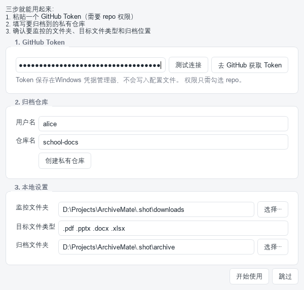

# ArchiveMate 归巢 · 使用说明

把学校下发的作文模板、课件、PDF、Word 自动收进一个 GitHub 私有仓库，本地只留一份备份，
随时能把电脑上的文件删掉腾空间。

---

## 一、这个东西是干什么的

- **自动盯着几个文件夹**：比如「下载」文件夹，你从班级群下载的 `.pptx`、`.pdf` 一出现，它就记下来。
- **自动分类**：按「年份 / 月份 / 类型」排好，例如 `2026/10/ppt/数学课件.pptx`。
- **推到你的 GitHub 私有仓库**：别人看不到，只有你自己能访问，而且每次推送都有历史版本。
- **推送成功后把本地文件挪到归档文件夹**：不是直接删除，你可以确认没问题之后再清空。

一句话：**电脑上的学校资料 → 自动搬到 GitHub，本地腾出空间。**

---

## 二、安装与启动

ArchiveMate 是绿色软件，不用安装：

1. 把整个 `ArchiveMate` 文件夹解压到任意位置，比如 `D:\ArchiveMate`。
2. 双击 `ArchiveMate.exe`。

> ⚠ **不要**把文件夹放在「下载」里，也不要只把 exe 单独拖出来——
> 配置、日志、缓存都存在 exe 旁边的文件夹里，少了运行库会打不开。
>
> 想让软件跟着 U 盘走，直接把整个文件夹拷到 U 盘即可，配置一起带走。

第一次打开会弹出**三步引导**：



### 第 1 步：填 GitHub Token

Token 相当于「一次性的密码」，用来让软件代替你操作仓库。获取方法：

1. 点引导页里的 **去 GitHub 获取 Token** 按钮，浏览器会直接跳到新建 Token 的页面
   （也可以手动打开 <https://github.com/settings/tokens>，需先登录 GitHub）。
2. 点右上角 **Generate new token → Generate new token (classic)**。
3. **Note** 随便写，比如 `ArchiveMate`。
4. **Expiration** 建议选 `90 days` 或 `No expiration`（到期后要重新生成）。
5. **Select scopes** 只勾选一项：☑ **repo**
   （完整勾选 `repo` 下面的全部子项；不需要 `admin`、`delete_repo` 等权限。）
6. 拉到底点 **Generate token**。
7. 页面上会出现一串 `ghp_` 开头的字符，**只显示这一次**，复制它。

回到 ArchiveMate，把 Token 粘进第一个输入框，然后：

- 输入框失去焦点（或按回车）时会**自动验证一次**，也可以点 **测试连接** 手动验证。
- 验证通过：下方显示绿色「✓ 连接成功，已登录为 你的用户名」，
  并把你填入的**用户名**后面那一栏（第 2 步的「用户名」）**自动填好**。
- 验证失败：显示红色原因，最常见的是「Token 无效或已过期」，重新生成一个即可。

> 🔒 Token 存在 Windows 的「凭据管理器」里，**不会写进配置文件、不会明文落盘**。
> 换电脑或重装系统后需要重新填一次。

### 第 2 步：选仓库

- **用户名**：你的 GitHub 用户名。验证 Token 通过后会自动填上，一般不用自己写。
- **仓库名**：自己起一个，比如 `school-files`。**留空就用 `school-files`**。
- 点 **创建私有仓库**：如果这个仓库还不存在，软件会帮你建一个**私有**仓库并勾上 README。
  - 已经有仓库？直接填名字即可，不用点创建。

### 第 3 步：本地设置

- **监控文件夹**：默认是「下载」文件夹。点「选择…」可以换成班级群文件的保存位置。
- **目标文件类型**：默认 `.pdf .pptx .docx .xlsx`。想连 `.ppt`、`.doc` 一起收就补上。
- **归档文件夹**：推送成功后本地文件挪到哪里。默认 `C:\Users\<你>\ArchiveMate归档`，
  建议改成磁盘空间富裕的位置。

点 **开始使用** 就进入主界面了。

---

## 三、主界面怎么用


```
┌─────────────────────────────────────────────────────────────┐
│  ArchiveMate 归巢    [待机]    [取消同步] [立即同步] [扫描] [设置]│
├────────────────────┬────────────────────────────────────────┤
│ 监控文件夹          │   ┌──────────────────────────────┐    │
│  D:\...\Downloads  │   │      把文件拖到这里           │    │
│  [添加文件夹][移除] │   │  支持自动分类后推送到 GitHub  │    │
│                    │   └──────────────────────────────┘    │
│ 目标文件类型        │   [挑选文件上传…] [移除选中]           │
│  .pdf .pptx        │                                        │
│  [添加类型][移除]   │   待推送队列                            │
│                    │   文件 | 目标位置 | 大小 | 来源 | 状态  │
│ 同步  每天 0 点 ▾  │   ────────────────────────────────     │
│  下次同步：10-18    │                                        │
│                    │                                        │
│ 归档文件夹          │   日志                                  │
│  D:\...\归档        │   ...                                  │
│  [打开][更换][清空] │                                        │
└────────────────────┴────────────────────────────────────────┘
```

### 三种把文件交给它的方式

| 方式 | 怎么做 | 适合什么时候 |
| --- | --- | --- |
| **自动监控** | 什么都不用做，把文件存进左边的监控文件夹 | 日常主力 |
| **拖拽** | 把文件从资源管理器拖进右边蓝色虚线框 | 临时几个文件 |
| **手动挑选** | 点「挑选文件上传…」 | 文件在别的地方 |

三种方式处理流程完全一样：分类 → 排队 → 推送 → 归档。

### 队列里那些状态是什么意思

| 状态 | 含义 | 怎么办 |
| --- | --- | --- |
| 待推送 | 已记录，等着传 | 点「立即同步」，或等定时同步 |
| 待推送（偏大） | 超过 50 MB，能传但会慢 | 想快点可以先压缩 |
| 已阻止 | 超过 90 MB，传不上去 | 压缩，或把类型从列表里去掉 |
| 推送失败 | 网络或权限出问题 | 看日志；修好后点「重新排队」 |
| 文件不见了 | 还没传，本地文件就被删/改名了 | 「移除选中」清掉这条记录 |

### 同步方式

- **手动**：点右上角「立即同步」（快捷键 `Ctrl+S`）。
- **定时**：左下角下拉框选 `每天 0 点 / 每周一 0 点 / 每月 1 号 0 点`，选「关闭」就不自动同步。
  选好之后下面会显示「下次同步：某月某日 00:00」，到那个时刻软件自己跑一次。

两种可以同时用。

### 同步要等多久

**正常情况下是几秒钟。** 一次同步只做这几件事：

1. 读一下远端仓库「现在有哪些文件」（两个很小的请求，几十毫秒到两三秒）；
2. 把你**这次新增的文件**上传；
3. 生成一次提交并让分支指向它。

关键在于：**它不会下载仓库里已有的文件**。所以哪怕你的仓库里已经攒了几百兆，
同步也不会变慢——这也是旧版本「一直停在正在同步远端仓库」的根因，已经改掉。

网络实在不好时，软件有三层保护，你不用怕它一直转下去：

1. **连接建立后没有数据**：超过「停滞上限」（默认 60 秒）没有任何进展，就自动放弃这次传输并报错。
2. **一次网络操作的总等待上限**：默认 1800 秒，到点一定会结束。
3. **「取消同步」按钮**：同步进行中，右上角会出现一个红色的「取消同步」。点了它会掐掉正在跑的 `git` 进程，队列内容原样保留，不会丢文件。

这三个都能在「设置 → 高级」里调：

| 设置项 | 默认 | 说明 |
| --- | --- | --- |
| 连接停滞上限 | 60 秒 | 连上之后多久收不到数据就放弃。填 `0` 表示关掉这条保护（不建议）。 |
| 一次网络操作上限 | 1800 秒 | 一次网络操作最多等这么久。传大文件时才会用到。 |
| 代理 | 空 | 例如 `http://127.0.0.1:7890`。国内直连不稳时建议填。 |

> 报错信息会告诉你是哪一类问题：证书问题、域名解析不了、Token 失效、仓库找不到、还是网络太慢。按提示处理即可，不用挨个试。

### 关于"归档文件夹"

推送成功后，本地文件会被**移动**到 `归档文件夹/年/月/类型/文件名`，
比如 `C:\...\ArchiveMate归档\2026\10\ppt\数学课件.pptx`。

这不是删除——文件还在你硬盘上，只是换了个地方。

**想彻底腾空间时**，点「清空归档」→ 确认。会弹二次确认框告诉你将删除多少个文件、占用多少空间。
删掉后本地就没有副本了，需要时去 GitHub 仓库下载。

---

## 四、常见问题

**Q：提示「找不到 git」怎么办？**
日常使用**不需要** Git——推送走的是 GitHub 的在线接口。
只有当你推送单个超过 45 MB 的大文件时，软件才会退回 `git` 命令行后端；
这时如果没装 Git，去 <https://git-scm.com/download/win> 下载安装，一路「下一步」即可。
（大文件本来就建议先压缩。）

**Q：国内推送很慢 / 一直失败？**
点「设置 → 高级 → 代理」，填你的代理地址，例如 `http://127.0.0.1:7890`。
常见的 Clash / V2Ray 默认就是这个端口。留空表示直连。

**Q：点了「立即同步」，一直显示「正在同步远端仓库……」不动了？**
当前版本不会这样：它只是读一下远端文件列表，一般一两秒就过去了。
如果确实卡住，直接点右上角的红色「**取消同步**」，队列内容原样保留，
不会有任何文件丢失。详见上面「同步要等多久」。

**Q：推送时报「证书校验失败」或者「schannel 拿不到凭据」？**
这是 git 建立 HTTPS 连接时的问题，跟你的 Token、仓库都没关系。
软件会**自己修**：识别到这类错误后，它会从 Windows 的证书库里导出系统信任的根证书，
自动改用 OpenSSL 后端再重试一次。日志里会出现一行
「HTTPS 连接被证书问题挡住，已自动改用 OpenSSL + 系统根证书重试一次」，
这属于正常现象，不用管它。

只有自动修复也没救回来时才需要动手：「设置 → 高级 → HTTPS 证书后端」，
把「跟随系统」改成 **OpenSSL**（或反过来），保存后再同步。
两个都不行的话，通常是公司或学校的网络做了证书拦截，需要先把它的根证书装进系统。

**Q：点「创建私有仓库」没反应 / 报错？**
先点旁边的「测试连接」看提示：Token 无效会说「Token 无效或已过期」，
权限不够会说「Token 权限不足」。确认 Token 勾了 `repo` 权限。

**Q：Token 会不会泄露？**
不会。Token 存在 Windows 凭据管理器里，配置文件里只有一个仓库地址。
推送时 Token 通过环境变量传给 git，**不会出现在任何命令行参数里**，日志也不会打印它。

**Q：能把文件传到 Gitee / 其他平台吗？**
不支持。设计上只对接 GitHub 私有仓库。

**Q：一个仓库能同时被几台电脑用吗？**
可以，但不建议同时推。软件在推送前会先读远端最新状态；**仓库里已有同名文件时，新文件会覆盖它**
（仓库里永远只保留最新那份，不会再堆出 `xxx (2).pdf`）。只有同一批里两个文件互相撞名时才会加 `(2)`
错开，避免丢文件。想保留旧版本就去 GitHub 的提交历史里翻，历史版本一直都在。

**Q：配置文件在哪？**
就在 `ArchiveMate.exe` 旁边：

| 文件 | 内容 |
| --- | --- |
| `config.json` | 监控文件夹、文件类型、归档路径、定时同步档位、仓库信息（**不含 Token**） |
| `state.json` | 待推送队列、历史记录、统计 |
| `logs\archivemate.log` | 运行日志（出问题时发这个文件） |
| `cache\repo.git` | 本地缓存仓库。日常同步走在线接口，这里基本是空的；只有推超大文件时才用得上 |

**Q：推送失败会丢文件吗？**
不会。只有**确认推送成功**之后才会把本地文件移进归档文件夹。失败的文件留在队列里，
下次同步会重试。

**Q：想暂时不监控某个文件夹？**
在左边列表选中它，点「移除」。文件夹本身和里面的文件都不会被动。

**Q：出问题了想自己排查？**
用同一个文件夹里的 `ArchiveMate-命令行.exe`，在命令提示符里运行：

```bat
ArchiveMate-命令行.exe doctor      :: 环境自检
ArchiveMate-命令行.exe status      :: 看配置和队列
ArchiveMate-命令行.exe sync        :: 命令行强制同步一次
ArchiveMate-命令行.exe --help      :: 全部命令
```

---

## 五、文件大小与限制

| 限制 | 数值 | 说明 |
| --- | --- | --- |
| 提醒阈值 | 50 MiB | 队列里标「偏大」，仍然会推送 |
| 拒绝阈值 | 90 MiB | 标「已阻止」，不推送 |
| 单次推送上限 | 2 GiB | 超过会自动拆成多批 |

GitHub 单个文件硬上限是 100 MB，所以 90 MiB 是留了余量的安全线。
大课件建议先压缩，或者用 Git LFS（软件暂不内置）。

---

## 六、许可与使用范围

本项目采用 **PolyForm Noncommercial License 1.0.0**（完整条款见软件目录下的 `LICENSE`，
或 <https://polyformproject.org/licenses/noncommercial/1.0.0>）。

- ✅ **免费**：自己用、同学之间传着用、学校等非营利机构使用都没问题，也可以自己改代码。
- ❌ **禁止商业用途**：不能拿它收费、不能打包进你卖的东西、不能作为商业服务的一部分。
- ❌ **禁止倒卖**：不得转售或通过收费渠道分发。
- 分发时请保留 `LICENSE` 文件。

需要商业授权请另行联系作者。软件按「现状」提供，不附带任何担保。
